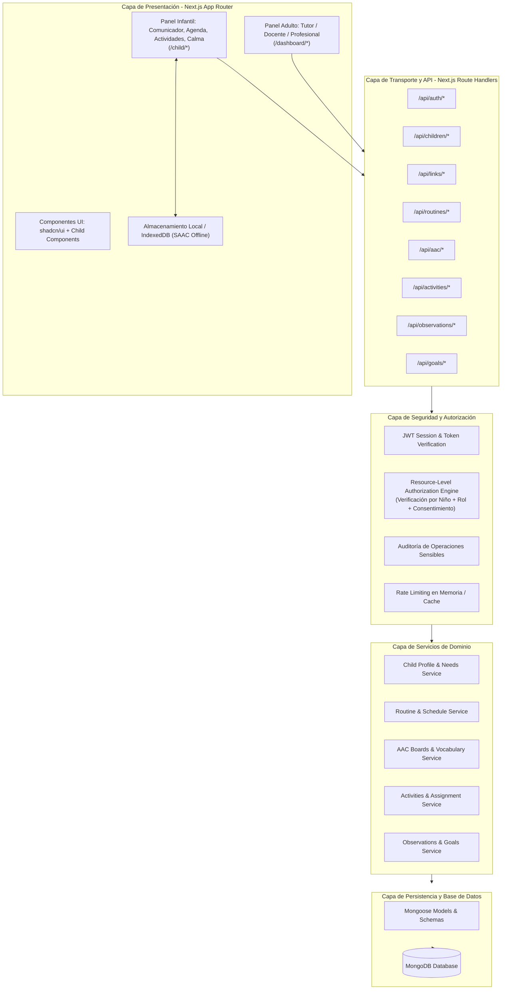

# Arquitectura del Sistema — Plataforma Integral de Apoyo para Niños Autistas

## 1. Visión General

La plataforma está diseñada siguiendo una arquitectura modular en capas, desacoplada y orientada al dominio, garantizando:
- **Seguridad por diseño (Security by Design)**: Validación en servidor, autorización por recurso y por perfil infantil, aislamiento de datos sensibles.
- **Doble experiencia de usuario diferenciada**: 
  - *Panel Administrativo*: Adultos (Tutores, Docentes, Profesionales) con UI profesional y accesible.
  - *Modo Infantil*: Niños, interfaz visual de baja carga cognitiva, táctil, amigable, accesible, sin menús administrativos ni riesgos de navegación errónea.
- **Resiliencia Offline**: El comunicador SAAC almacena localmente los pictogramas y tableros esenciales mediante IndexedDB y caché para funcionar sin conexión a internet.
- **Auditabilidad y Trazabilidad**: Registro de operaciones sensibles sin almacenar historiales de comunicación infantil íntima (respeto a la privacidad).

---

## 2. Diagrama de Capas de la Arquitectura



---

## 3. Estructura de Directorios del Código

```text
src/
├── app/
│   ├── (auth)/                 # Login, Registro, Recuperación
│   ├── (dashboard)/            # Vistas para Tutor, Profesional y Docente
│   │   ├── tutor/              # Gestión de niños, rutinas, permisos, auditoría
│   │   ├── professional/       # Objetivos terapéuticos, notas de evolución
│   │   └── teacher/            # Actividades pedagógicas y seguimiento
│   ├── child/                  # Entorno infantil protegido
│   │   ├── [childId]/
│   │   │   ├── aac/            # Comunicador SAAC con síntesis de voz
│   │   │   ├── schedule/       # Mi Día: Agenda visual y rutinas
│   │   │   ├── activities/     # Biblioteca de actividades (Asociación, Selección, Secuencias)
│   │   │   └── calm/           # Zona de calma (baja estimulación)
│   └── api/                    # Route Handlers con autenticación y autorización
│       ├── auth/
│       ├── children/
│       ├── links/
│       ├── routines/
│       ├── aac/
│       ├── activities/
│       ├── observations/
│       ├── goals/
│       └── audit/
├── components/
│   ├── ui/                     # Botones, Modales, Inputs, Selects
│   ├── shared/                 # Navbar, Sidebar, Alert, ConfirmDialog
│   ├── adult/                  # Tarjetas de progreso, formularios de configuración
│   └── child/                  # PictogramCard, BigButton, RoutineStepCard, VoicePlayer
├── features/
│   ├── aac/                    # Hooks de síntesis de voz, categorías y pictogramas
│   ├── routines/               # Lógica de cálculo de pasos y agenda visual
│   ├── activities/             # Motores de actividades (Asociación, Selección, Secuencias)
│   └── calm/                   # Control de sonidos y visuales de baja estimulación
├── lib/
│   ├── db/                     # Conexión persistente a MongoDB (Mongoose singleton)
│   ├── auth/                   # Creación, verificación y cookies JWT
│   ├── security/               # Motor de políticas y permisos (ABAC/RBAC)
│   ├── audit/                  # Registro de auditoría
│   └── validations/            # Esquemas Zod para formularios y endpoints
├── models/                     # Modelos Mongoose (User, Child, Routine, AAC, Activity, etc.)
└── types/                      # Definiciones de TypeScript
```

---

## 4. Estrategia de Seguridad y Autorización

1. **Principio de Mínimo Privilegio y Denegación por Defecto**:
   - Toda solicitud a la API pasa por `verifySession` y `authorizeChildAccess`.
   - Si no existe un registro activo en `ChildAccess` que vincule al usuario con el `childId` con el permiso específico, la solicitud es rechazada inmediatamente con HTTP 403 Forbidden.
2. **Protección contra IDOR (Insecure Direct Object Reference)**:
   - Jamás se consulta un recurso (`Routine`, `Activity`, `Observation`, `Goal`) usando únicamente el ID del recurso; siempre se valida su pertenencia al `childId` autorizado.
3. **Privacidad del Comunicador SAAC**:
   - Por diseño ético y de privacidad, las frases construidas en el comunicador SAAC **no se almacenan en la base de datos**. El SAAC es la voz del niño, no un registro de vigilancia.
4. **Modo Infantil Protegido**:
   - El niño ingresa a su panel a través de un enlace directo autorizado o código PIN supervisado por el tutor.
   - En el modo infantil no existen enlaces, cookies administrativas ni rutas que permitan modificar datos o consultar expedientes ajenos.

---

## 5. Resiliencia y Funcionamiento Offline

- **Web Speech API**: Utiliza el motor nativo de síntesis de voz del navegador en español (`es-ES`, `es-MX`, `es-US`).
- **IndexedDB / Web Storage**: Caché local de los pictogramas (ARASAAC y personalizados) para que el tablero de comunicación visual funcione sin conexión.
