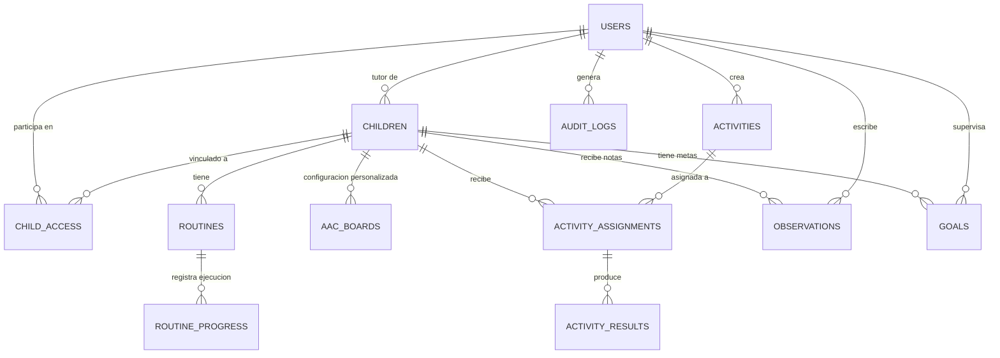

# Modelo de Base de Datos — MongoDB & Mongoose

## 1. Esquemas de Colecciones

A continuación se detalla la estructura formal de datos de la plataforma, modelada en MongoDB con Mongoose.

---

## 2. Definición Detallada de Modelos

### 2.1. `User` (Colección: `users`)
- `_id`: ObjectId
- `name`: String (Requerido)
- `email`: String (Único, Indexado, Lowercase)
- `passwordHash`: String (Requerido)
- `role`: Enum `['tutor', 'professional', 'teacher']`
- `specialty`: String (Opcional, e.g. "Fonoaudiología", "Educación Diferencial")
- `isActive`: Boolean (Default: true)
- `createdAt`, `updatedAt`: Date

### 2.2. `Child` (Colección: `children`)
- `_id`: ObjectId
- `tutorId`: ObjectId (Ref: `User`, Indexado)
- `name`: String (Requerido)
- `nickname`: String (Opcional, nombre preferido)
- `birthDate`: Date (Opcional)
- `avatarUrl`: String
- `pinCode`: String (Hash de PIN de 4 dígitos para acceso supervisado en modo niño)
- `individualizedProfile`:
  - `interests`: [String] (Temas de hiperfoco o motivación)
  - `sensoryPreferences`: [String] (Luces suaves, texturas, silencio)
  - `communicationModes`: [String] (Pictogramas, habla gestual, verbal, vocal)
  - `preferredVisualSupports`: [String] (Agendas verticales, secuencias numéricas)
  - `selfRegulationStrategies`: [String] (Movimiento, balanceo, refugio en calma)
  - `knownDiscomforts`: [String] (Ruidos estridentes, cambios imprevistos)
  - `notes`: String
- `accessibility`:
  - `fontSize`: Enum `['normal', 'large', 'extra-large']` (Default: 'large')
  - `buttonSize`: Enum `['normal', 'large', 'extra-large']` (Default: 'large')
  - `contrast`: Enum `['normal', 'high', 'soft']` (Default: 'normal')
  - `reducedMotion`: Boolean (Default: true)
  - `soundEnabled`: Boolean (Default: true)
  - `voiceTtsEnabled`: Boolean (Default: true)
  - `voiceSpeed`: Number (Default: 0.9, rango 0.5 - 1.5)
  - `columnsCount`: Number (Default: 4, opciones 2, 3, 4, 6)
- `createdAt`, `updatedAt`: Date

### 2.3. `ChildAccess` (Colección: `child_access`)
Manejo de vinculaciones seguras y permisos por recurso:
- `_id`: ObjectId
- `childId`: ObjectId (Ref: `Child`, Indexado)
- `userId`: ObjectId (Ref: `User`, Indexado)
- `invitedBy`: ObjectId (Ref: `User`)
- `role`: Enum `['tutor', 'professional', 'teacher']`
- `status`: Enum `['pending', 'accepted', 'rejected', 'revoked']` (Default: 'pending')
- `permissions`: [String] (Conjunto de permisos autorizados: `routine.read`, `activity.assign`, etc.)
- `createdAt`, `updatedAt`: Date
- *Índice compuesto*: `{ childId: 1, userId: 1 }` (Único)

### 2.4. `Routine` (Colección: `routines`)
- `_id`: ObjectId
- `childId`: ObjectId (Ref: `Child`, Indexado)
- `title`: String
- `description`: String
- `category`: Enum `['manana', 'tarde', 'noche', 'escuela', 'higiene', 'especial']`
- `daysOfWeek`: [Number] (0: Domingo, 1: Lunes, etc.)
- `startTime`: String (Formato HH:mm)
- `isActive`: Boolean (Default: true)
- `steps`: Array de subdocumentos:
  - `id`: String (UUID)
  - `order`: Number
  - `title`: String
  - `description`: String
  - `iconUrl`: String
  - `audioUrl`: String
  - `estimatedMinutes`: Number
- `createdAt`, `updatedAt`: Date

### 2.5. `RoutineProgress` (Colección: `routine_progress`)
- `_id`: ObjectId
- `childId`: ObjectId (Ref: `Child`, Indexado)
- `routineId`: ObjectId (Ref: `Routine`, Indexado)
- `date`: String (YYYY-MM-DD, Indexado)
- `completedStepIds`: [String]
- `status`: Enum `['not_started', 'in_progress', 'completed', 'skipped']`
- `notes`: String
- `completedAt`: Date

### 2.6. `AACBoard` (Colección: `aac_boards`)
Tableros de comunicación aumentativa:
- `_id`: ObjectId
- `childId`: ObjectId (Ref: `Child`, Indexado, opcional si es catálogo global predeterminado)
- `isCustom`: Boolean (Default: false)
- `columnsCount`: Number (Default: 4)
- `categories`: Array de subdocumentos:
  - `id`: String
  - `name`: String
  - `icon`: String
  - `color`: String
  - `order`: Number
- `items`: Array de subdocumentos:
  - `id`: String
  - `categoryId`: String
  - `label`: String
  - `imageUrl`: String
  - `audioText`: String
  - `isQuickAccess`: Boolean (Acceso directo permanente como: Sí, No, Ayuda, etc.)
  - `order`: Number
- `createdAt`, `updatedAt`: Date

### 2.7. `Activity` (Colección: `activities`)
- `_id`: ObjectId
- `title`: String
- `description`: String
- `skillType`: String (e.g., "Atención y Reconocimiento", "Categorización", "Secuencia Temporal")
- `activityType`: Enum `['association', 'selection', 'sequence']`
- `difficulty`: Enum `['facil', 'medio', 'avanzado']`
- `instructions`: String
- `config`:
  - En `association`: `{ pairs: [{ id: string, leftText: string, leftImage: string, rightText: string, rightImage: string }] }`
  - En `selection`: `{ questions: [{ id: string, promptText: string, promptImage: string, options: [{ id: string, text: string, imageUrl: string, isCorrect: boolean }] }] }`
  - En `sequence`: `{ steps: [{ id: string, order: number, text: string, imageUrl: string }] }`
- `createdBy`: ObjectId (Ref: `User`)
- `isTemplate`: Boolean (Default: false)
- `createdAt`, `updatedAt`: Date

### 2.8. `ActivityAssignment` y `ActivityResult`
- `ActivityAssignment`: `childId`, `activityId`, `assignedBy`, `dueDate`, `status` (`'pending' | 'completed' | 'cancelled'`), `assignedAt`.
- `ActivityResult`: `assignmentId`, `childId`, `activityId`, `score`, `totalItems`, `supportsUsed`: [String] (e.g., "pista visual", "lectura en voz alta"), `timeSpentSeconds`, `feedbackNotes`, `createdAt`.

### 2.9. `Observation` (Colección: `observations`)
Línea temporal de notas pedagógicas y de bienestar:
- `_id`: ObjectId
- `childId`: ObjectId (Ref: `Child`, Indexado)
- `authorId`: ObjectId (Ref: `User`)
- `date`: Date
- `category`: Enum `['bienestar', 'sensorial', 'descanso', 'conductual', 'social', 'pedagogico']`
- `description`: String
- `supportsUsed`: [String]
- `observedOutcome`: String
- `visibility`: [Enum `['tutor', 'professional', 'teacher']`]
- `createdAt`: Date

### 2.10. `Goal` (Colección: `goals`)
Objetivos individualizados:
- `_id`: ObjectId
- `childId`: ObjectId (Ref: `Child`, Indexado)
- `description`: String
- `area`: Enum `['comunicacion', 'autonomia', 'social', 'cognitiva', 'sensorial']`
- `responsibleId`: ObjectId (Ref: `User`)
- `startDate`: Date
- `targetDate`: Date
- `criteria`: String (Criterio observable de avance)
- `status`: Enum `['propuesto', 'en_progreso', 'alcanzado', 'pausado']`
- `progressNotes`: [{ date: Date, note: String, authorId: ObjectId }]
- `createdAt`, `updatedAt`: Date

### 2.11. `AuditLog` (Colección: `audit_logs`)
- `_id`: ObjectId
- `userId`: ObjectId (Ref: `User`, Indexado)
- `childId`: ObjectId (Ref: `Child`, Indexado, opcional)
- `action`: String (e.g., `AUTH_LOGIN`, `LINK_CREATED`, `PERMISSION_CHANGED`, `LINK_REVOKED`, `CHILD_UPDATED`)
- `resource`: String
- `details`: Object
- `ipAddress`: String
- `userAgent`: String
- `timestamp`: Date
